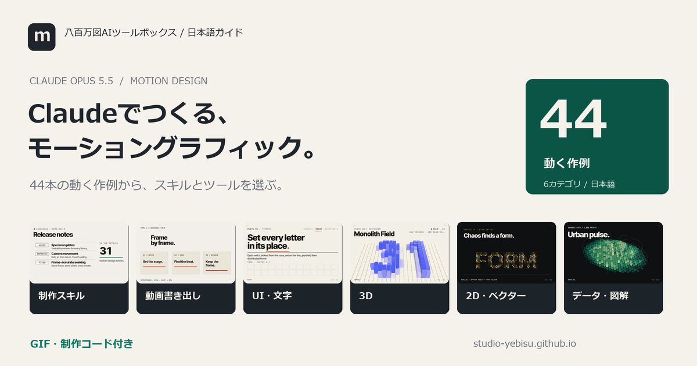

# Claude モーショングラフィック制作ガイド

Claudeを活用したモーショングラフィックスの制作スタックと実装コードをまとめたガイドです。44件のスキル・ツール・参考資料について、元の役割、機能デモ、GIF、編集可能な実装コードを掲載しています。

**[サイトを開く](https://studio-yebisu.github.io/awesome-claude-motion-design-ja/)** · **[44本の作例を見る](https://studio-yebisu.github.io/awesome-claude-motion-design-ja/projects.html)** · **[制作の始め方](https://studio-yebisu.github.io/awesome-claude-motion-design-ja/guide.html)**



## ガイドの内容

- **投稿15件の使い分け**：[モーション制作スキル7件を新たに紹介](https://studio-yebisu.github.io/awesome-claude-motion-design-ja/guide.html#motion-production-skills)。用途・導入・利用条件を比較し、既掲載7件とUI/UX側の1件へ案内します。新7件は資料の確認段階で、作例の本数とは分けています。
- **44本の作例**：テキスト演出、UI、3D、2D、図解など各ツールの特性に合わせた作例。拡大再生して動きを確認できます。
- **GIFと実装コード**：動きと実装をその場で確認し、コードをコピーして再現・編集できます。
- **6カテゴリと4つの制作ルート**：用途や実行環境に応じた組み合わせを選択できます。
- **Claude Motion（公式ベータ）**：[チャットから制作する方法](https://studio-yebisu.github.io/awesome-claude-motion-design-ja/guide.html#claude-motion)。Team・Enterpriseの利用条件と、Charlie Hillsの制作手順・16種の作例記事を紹介しています。
- **動きを詰める方法**：[指示の具体化とフレーム単位の修正](https://studio-yebisu.github.io/awesome-claude-motion-design-ja/guide.html#motion-direction)。実験記事の要約と、コピーして使える修正ブリーフを掲載しています。
- **グラフと関係図**：[数値・工程・ネットワークを動かす](https://studio-yebisu.github.io/awesome-claude-motion-design-ja/guide.html#data-visualization)。Chart.js、ECharts、Mermaid、React Flowなど9件を追加し、用途と独自作例を比較できます。

- **日本語の制作スキル**：[Motion Reel](https://studio-yebisu.github.io/awesome-claude-motion-design-ja/guide.html#motion-reel)。ブリーフ、時刻指定描画、音の同期、フレームレビュー、MP4書き出しをつなぐ独自スキルです。
- **40秒の紹介動画**：作例31本を用いた紹介映像。[制作コード・構成表](examples/remotion/PROMO_README.md)（Suno楽曲含む）も確認できます。

## 4つの制作ルート

チャット内で制作する公式サービスは[Claude Motionの案内](docs/Claude%20Motion.md)へ。下の4ルートは、コードと制作環境を組み合わせてつくる方法です。

| つくりたいもの | 主なスタック | 詳細解説 |
| --- | --- | --- |
| 商品紹介・文字演出 | HyperFrames + 公式制作スキル + HTML | [HTML動画ルート](https://studio-yebisu.github.io/awesome-claude-motion-design-ja/guide.html#html) |
| テンプレート・数値差し替え | Remotion + 公式Agent Skills + React | [React動画ルート](https://studio-yebisu.github.io/awesome-claude-motion-design-ja/guide.html#react) |
| 操作に反応するUI・Web | Motion / GSAP + Emil Kowalski Skills | [Web UIルート](https://studio-yebisu.github.io/awesome-claude-motion-design-ja/guide.html#web) |
| 数式・アルゴリズムの図解 | Manim / Motion Canvas + シーン構成 | [解説動画ルート](https://studio-yebisu.github.io/awesome-claude-motion-design-ja/guide.html#explain) |

## スキル・ツール一覧


### 制作スキル・事例（11件）

| スキル・ツール | 使いどころ | ライセンス |
| --- | --- | --- |
| [Remotion Agent Skills](https://github.com/remotion-dev/skills) | Reactを用いた動画制作全般。 | [独立LICENSE未確認](https://github.com/remotion-dev/skills/blob/7ba4dcf8ebe1626b00baa41e1f2478113719b60b/README.md) |
| [Emil Kowalski Skills](https://github.com/emilkowalski/skills) | UIコンポーネントやインタラクションの改善。 | [MIT](https://github.com/emilkowalski/skills/blob/2d228630ba1446365f614a108cb8252f1feda202/LICENSE) |
| [Motion Graphics Skill Pack](https://github.com/charlie947/motion-graphics-skills) | トーン＆マナーを統一した告知動画やプロモーション映像の制作。 | [MIT](https://github.com/charlie947/motion-graphics-skills/blob/229022ebca76972e119e36ada23a1648d51665ab/LICENSE) |
| [claude-motion](https://github.com/whaleyxbt/claude-motion) | 映像と効果音をフレーム単位で同期させる動画制作。 | [MIT](https://github.com/whaleyxbt/claude-motion/blob/e627941543d9988b155dc610bb9cc0115a5e365e/LICENSE) |
| [claude-motion-design](https://github.com/howseen-ai/claude-motion-design) | Web技術を用いたモーショングラフィックスの動画書き出し。 | [MIT](https://github.com/howseen-ai/claude-motion-design/blob/3d90d349ef3fdde9b7e89de4df4a2159c9e8697f/LICENSE) |
| [/motion for Claude Code](https://github.com/abhimahamkali/claude-motion-skill) | 図形やメタファーを用いた短い解説映像の作成。 | [LICENSE未確認](https://github.com/abhimahamkali/claude-motion-skill/blob/37d44b5d2db8e28c4ebf011cb8f1bd1e260ac09c/README.md) |
| [Anatomy](https://github.com/wheresryan22/anatomy) | 機械・装置・技術の仕組みを、操作できる立体図で伝える。 | [MIT](https://github.com/wheresryan22/anatomy/blob/e6600ffc4e8e6620eeb45bf49bcdbd5e4b84163f/LICENSE) |
| [iart.ai Motion Skills](https://github.com/iart-ai/motion-skills) | 目的の表現に応じた専用プロンプトやスキルの選択。 | [MIT（索引）](https://github.com/iart-ai/motion-skills/blob/4a9822375b589294aa369fde44205c62dfcf9c27/LICENSE) |
| [Opus 5.5 Video Prompts](https://github.com/apimodels/claude-opus-5-5-video-prompts) | プロンプトの記述粒度や技術選定パターンの調査。 | [CC BY 4.0（編集資料）](https://github.com/apimodels/claude-opus-5-5-video-prompts/blob/383335d1ed1a6a6d84b772d7c802ca0d221f6410/LICENSE) |
| [Motion Reel / Studio Yebisu](https://github.com/studio-yebisu/motion-reel) | 商品紹介、UIの変形、文字や図形の短い映像を、編集できるソースと確認資料付きで制作する。 | [MIT](https://github.com/studio-yebisu/motion-reel/blob/56198544e69201b1c202e0c00fb90b568a729824/LICENSE) |
| [Machine Skill](https://github.com/AirsupHQ/machine-skill) | エンジンやポンプなどの機構説明、製品紹介、技術教材。断面・分解・X線・入力変更・故障の再現を、操作できるモデルと動画で見せる。 | [MIT](https://github.com/AirsupHQ/machine-skill/blob/35074a98b14c5f414e446cbb53bd8b1798ff70cc/LICENSE) |

### 動画制作・書き出し（7件）

| スキル・ツール | 使いどころ | ライセンス |
| --- | --- | --- |
| [HyperFrames](https://github.com/heygen-com/hyperframes) | Web技術で構築するプロモーション動画やSNSコンテンツ。 | [Apache-2.0](https://github.com/heygen-com/hyperframes/blob/fbbc4e88c59c01bfec69368a9a587d3438a7d32a/LICENSE) |
| [Remotion](https://github.com/remotion-dev/remotion) | データ駆動型動画、字幕入りコンテンツ、動画テンプレートの量産。 | [Remotion License](https://github.com/remotion-dev/remotion/blob/d5f455390933ab7a48d6ca79a5f4f0223234a802/LICENSE.md) |
| [Motion Canvas](https://github.com/motion-canvas/motion-canvas) | プログラミングやアルゴリズム、技術的な仕組みの解説動画。 | [MIT](https://github.com/motion-canvas/motion-canvas/blob/7b91435c301d530351dcf5ebb91dd139c002e405/LICENSE) |
| [FFmpeg](https://github.com/FFmpeg/FFmpeg) | 連番画像からの動画作成、音声合成、解像度やビットレートの調整。 | [LGPL／GPL（構成による）](https://github.com/FFmpeg/FFmpeg/blob/6ef3b1ba966233a0964bcc4aa1c2e20d014a5052/LICENSE.md) |
| [ffmpeg.wasm](https://github.com/ffmpegwasm/ffmpeg.wasm) | サーバーを介さずにブラウザ内で完結する動画変換・編集Webツール。 | [MIT（wrapper）＋coreの条件](https://ffmpegwasm.netlify.app/docs/faq/#what-is-the-license-of-ffmpegwasm) |
| [Mediabunny](https://github.com/Vanilagy/mediabunny) | 高速なブラウザ完結型動画エディタやレンダリング機能の実装。 | [MPL-2.0](https://github.com/Vanilagy/mediabunny/blob/cc108b3b492d1e00aa976586b6d3f344a0bd178d/LICENSE) |
| [Playwright](https://github.com/microsoft/playwright) | <code>seek(t)</code>で指定したフレームの連番キャプチャや表示崩れのテスト。 | [Apache-2.0](https://github.com/microsoft/playwright/blob/d9f2fd3e2232ace8e317a84eda6cb86e25bcf49c/LICENSE) |

### UI・文字のアニメーション（4件）

| スキル・ツール | 使いどころ | ライセンス |
| --- | --- | --- |
| [Motion](https://github.com/motiondivision/motion) | インタラクティブなUI、画面遷移、マイクロインタラクション。 | [MIT](https://github.com/motiondivision/motion/blob/e6bf03ead39cae7a2c5f8fe902ce8a9c1a9a22e8/LICENSE.md) |
| [GSAP](https://github.com/greensock/GSAP) | 複雑なシーケンスアニメーションや、一時停止タイムラインを用いた動画書き出し。 | [GSAP独自ライセンス](https://gsap.com/community/standard-license/) |
| [Anime.js](https://github.com/juliangarnier/anime) | SVGパスのアニメーション、幾何学模様のモーフィング、スタッガー演出。 | [MIT](https://github.com/juliangarnier/anime/blob/01b81be1df6843ccfe0a71c0699a746bf740dd77/LICENSE.md) |
| [canvas-confetti](https://github.com/catdad/canvas-confetti) | タスク完了、実績解除、祝賀演出のUIアニメーション。 | [ISC](https://github.com/catdad/canvas-confetti/blob/20eebad51dde793070c373d594099a7ed8d96e22/LICENSE) |

### 3D・シェーダー（7件）

| スキル・ツール | 使いどころ | ライセンス |
| --- | --- | --- |
| [Three.js](https://github.com/mrdoob/three.js) | 3Dモデルの表示、カメラワーク、ライティング、シェーダー表現。 | [MIT](https://github.com/mrdoob/three.js/blob/2a8cd874803effdc99cf2db0cd0ff2f683d69389/LICENSE) |
| [React Three Fiber](https://github.com/pmndrs/react-three-fiber) | Reactアプリケーション内での3Dシーンの構築と状態連動。 | [MIT](https://github.com/pmndrs/react-three-fiber/blob/9e53355ce499ea518ac3729de7fd4dcc06d8cdb9/LICENSE) |
| [Drei](https://github.com/pmndrs/drei) | 3Dビューアのセットアップやスタジオライティングの簡略化。 | [MIT](https://github.com/pmndrs/drei/blob/bf6f4addf47467d3885de272d94ca5127f6ef68f/LICENSE) |
| [Cobe](https://github.com/shuding/cobe) | 拠点表示、グローバルネットワーク、データビジュアライゼーション。 | [MIT](https://github.com/shuding/cobe/blob/7e94076fa8c38707f4c9cd114ff4f7c5c880971e/LICENSE) |
| [TWGL.js](https://github.com/greggman/twgl.js) | カスタムGLSLシェーダーを用いた背景演出やポストプロセスの実装。 | [MIT](https://github.com/greggman/twgl.js/blob/aa33c0aa5b095e57b9a5cde0cf241e66a6c95f2e/LICENSE.md) |
| [Code Video Model](https://github.com/code-video-model/CodeVideoModel) | カメラ、物体の配置、動きの順番をコードで調整し、その条件をAI動画の仕上げへつなぐ。 | [Apache-2.0（コード）](https://github.com/code-video-model/CodeVideoModel/blob/404e03d67c2977b441622ce94411470bb84984a8/LICENSE) |
| [3d-force-graph](https://github.com/vasturiano/3d-force-graph) | 関係の密度やクラスタを立体で見せ、カメラから全体を観察する。 | [MIT](https://github.com/vasturiano/3d-force-graph/blob/5ccd00f47d72a571319da70ccac080bb8e09709f/LICENSE) |

### 2D・ベクター（4件）

| スキル・ツール | 使いどころ | ライセンス |
| --- | --- | --- |
| [Fabric.js](https://github.com/fabricjs/fabric.js) | グラフィックエディタ機能、オブジェクト単位でのアニメーション管理。 | [MIT](https://github.com/fabricjs/fabric.js/blob/54f050648cb67f7066b108f63cf1824039860d92/LICENSE) |
| [Rive Runtimes](https://github.com/rive-app/rive-runtime) | ユーザー操作や状態変化に動的かつ滑らかに応答するキャラクターやUI要素。 | [MIT（runtime）](https://github.com/rive-app/rive-runtime/blob/daf55385b71fb861b2a1ae2930ae4492832d5db5/LICENSE) |
| [Lottie Web](https://github.com/airbnb/lottie-web) | デザイナーが作成したベクターアニメーションのWeb・アプリ組み込み。 | [MIT](https://github.com/airbnb/lottie-web/blob/bede03d25d232826e0c9dca1733d542d8a7754fb/LICENSE.md) |
| [PixiJS](https://github.com/pixijs/pixijs) | 大量のパーティクル演出、リッチな2Dビジュアル、ミニゲーム的表現。 | [MIT](https://github.com/pixijs/pixijs/blob/65552017d23255c1442a7d4ac7f0d49e3225fb1d/LICENSE) |

### データ・図解（11件）

| スキル・ツール | 使いどころ | ライセンス |
| --- | --- | --- |
| [deck.gl](https://github.com/visgl/deck.gl) | 数千〜数十万件の位置情報、移動フロー、密度分布の可視化。 | [MIT](https://github.com/visgl/deck.gl/blob/d9e395c935d962740e4b6debb7b63e1b4391b1b5/LICENSE) |
| [D3](https://github.com/d3/d3) | カスタムチャート、インタラクティブなグラフ、統計データのトランジション表現。 | [ISC](https://github.com/d3/d3/blob/ca958d45217b4c15332d971b935451a6d4c978f4/LICENSE) |
| [Manim Community](https://github.com/ManimCommunity/manim) | 数学、物理、コンピュータサイエンスの概念解説動画の作成。 | [MIT](https://github.com/ManimCommunity/manim/blob/a6d5cc02b430fb57d22add51236b6406fbf19d91/LICENSE) |
| [Mermaid](https://github.com/mermaid-js/mermaid) | 制作フローやシーンの分岐を整理し、図解を順番に見せる。 | [MIT](https://github.com/mermaid-js/mermaid/blob/4e3a85e6d46a0326379e04db3463bb3b53a3ca94/LICENSE) |
| [Chart.js](https://github.com/chartjs/Chart.js) | 数値の推移、比較、レポートの要点をグラフで伝える。 | [MIT](https://github.com/chartjs/Chart.js/blob/7169e65147a47f3720957a6f156a33c838ab9f57/LICENSE.md) |
| [Apache ECharts](https://github.com/apache/echarts) | 複数系列、ヒートマップ、ダッシュボードの変化を説明する。 | [Apache-2.0](https://github.com/apache/echarts/blob/34f4d927eafe251f26f63afd3aeefa30f2feba30/LICENSE) |
| [React Flow / Svelte Flow](https://github.com/xyflow/xyflow) | 制作工程、分岐、依存関係をノード単位で説明するUI。 | [MIT](https://github.com/xyflow/xyflow/blob/3d35b57317576b0916c0bfeaaedd573aaacc2839/LICENSE) |
| [Plotly.js](https://github.com/plotly/plotly.js) | 波形や測定値、数式から得たデータの変化を可視化する。 | [MIT](https://github.com/plotly/plotly.js/blob/4862f6271046024e58cd25bfa771e81ffe2fdce6/LICENSE) |
| [Nivo](https://github.com/plouc/nivo) | Reactの画面やテンプレートで、数値を差し替えるチャート。 | [MIT](https://github.com/plouc/nivo/blob/0dae2c32052a573f9f1d66ec1b453b572119b265/LICENSE.md) |
| [AntV G6](https://github.com/antvis/G6) | サービス依存、組織、知識のつながりを配置と強調で見せる。 | [MIT](https://github.com/antvis/G6/blob/bdf6a55cd346afa5429e38083b380081734c6ff9/LICENSE) |
| [Cytoscape.js](https://github.com/cytoscape/cytoscape.js) | 最短経路、接続関係、ネットワークの一部分を説明する。 | [MIT](https://github.com/cytoscape/cytoscape.js/blob/7ba634095d8954089ee5dc09ada0030f2dca134c/LICENSE) |

## 再現と編集の手順

各項目には用途、必要要件、Claudeとの連携方法、公式リポジトリおよびライセンスへのリンクを掲載しています。RemotionやGSAPの独自条件、各モデルやスキルの利用条件は導入前にご確認ください。

- [ツールの選定基準](docs/調査ノート.md)
- [ライセンスと出典一覧](docs/出典とライセンス.md)
- [作例の制作記録](docs/作例の制作記録.md)
- [全件のツール・スキルとデモの対応、実行範囲](docs/ツールと作例の対応.md)
- [制作コードと再現手順](examples/README.md)
- [使用制作スタック](docs/制作スタック.md)
- [動きを詰める：実験記事の要約と実装の参照先](docs/動きを詰める.md)
- [グラフと関係図：追加9件の用途と確認範囲](docs/データと図解.md)
- [投稿15件から選ぶモーション制作スキル・ツール](docs/モーション制作スキル15選.md)

使用バージョン・動画ファイル・コードの詳細は[data/preview-production.json](data/preview-production.json)、リポジトリの検証データは[data/verification.json](data/verification.json)に記録しています。

## ローカルでの表示方法

Python 3環境で静的サイトを生成・プレビューできます。

```text
python scripts/build_site.py
python scripts/check_site.py
python -u -m http.server 0 --bind 127.0.0.1
```

実行後にターミナルに表示されたURLをブラウザで開きます。公開はGitHub Pagesの`main`ブランチ（ルートディレクトリ）です。

編集対象ファイルは[data/curation.json](data/curation.json)、[templates](templates/)、[assets](assets/)です。`index.html`、`projects.html`、`guide.html`、`data/projects.json`、本README、[ツールと作例の対応](docs/ツールと作例の対応.md)はスクリプトによるビルド生成物です。詳細は[コントリビューションガイド](CONTRIBUTING.md)を参照してください。

一次資料の更新には[scripts/collect_sources.py](scripts/collect_sources.py)を使用します（`--evidence-dir`には公開リポジトリ外のパスを指定）。

## 関連ガイド

- [Claude UI・UXデザインガイド](https://github.com/studio-yebisu/awesome-claude-ui-ux-design-ja)：画面設計・操作性・アクセシビリティのスキルを別リポジトリに整理。
- [AIスライド制作ガイド](https://studio-yebisu.github.io/awesome-codex-ppt-skills-ja/)

## ライセンス

本ガイドの文章、データ、コード、図版は[MITライセンス](LICENSE)で公開しています。各ライブラリ、フォント、素材、APIには個別のライセンスが適用されます。詳細は[出典とライセンス](docs/出典とライセンス.md)をご確認ください。
